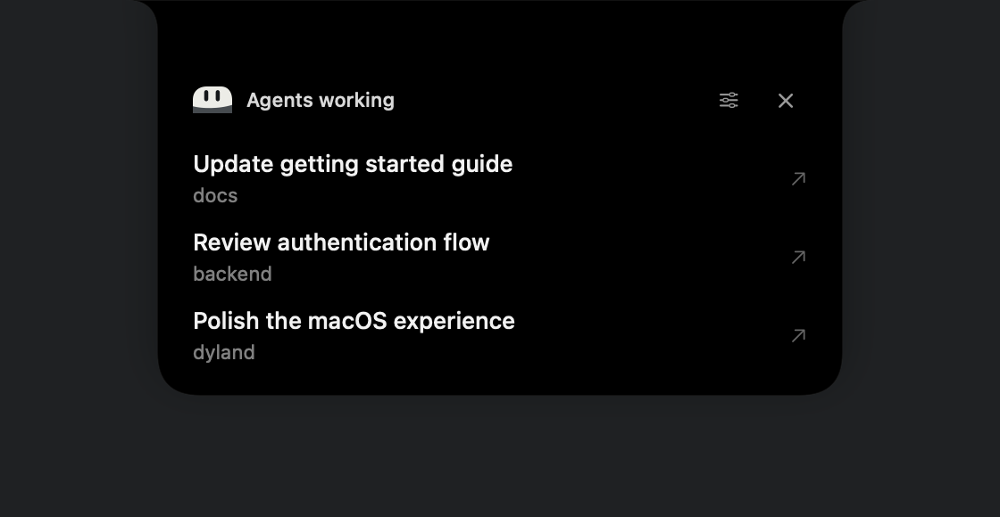
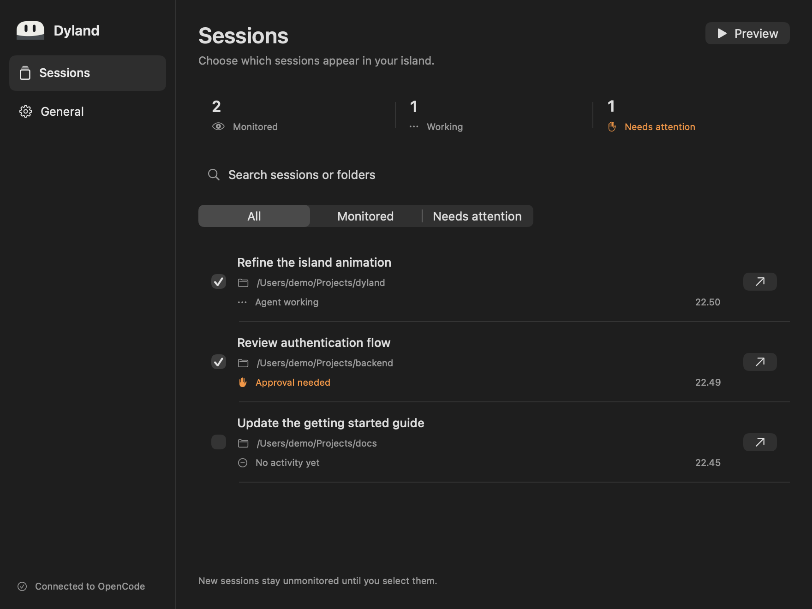

# Dyland

**A local Dynamic Island for OpenCode sessions on macOS.**

[](#requirements)
[](#requirements)
[](#build-and-test)
[](LICENSE)

Know when an agent finishes, needs an answer, or asks for approval without watching every terminal.
Dyland is a native SwiftUI and AppKit menu bar app, with a small OpenCode plugin and a local file bridge.
No Electron, additional HTTP server, or hosted notification service.



Screenshots use the real SwiftUI views with demo session data, not private OpenCode sessions.

## Features

- Monitor only the sessions you select, with selections saved by session ID.
- See working, completion, question, permission, error, and interruption states.
- Keep pending questions and permission requests available until handled in OpenCode.
- Click a notification to open its exact session in Ghostty or a new Warp tab.
- Play the bundled `dyland-sound.mp3` for events that need attention.
- Expand details on hover without taking keyboard focus.
- Blend into a display notch, or use the top center of a display without one.
- Use native settings, optional launch at login, and animations that respect Reduce Motion.




## Requirements

| Requirement | Details |
| --- | --- |
| macOS | 14 or later, on Apple Silicon |
| Swift | Swift 6 toolchain with the macOS SDK, supplied by compatible Xcode or Xcode Command Line Tools |
| Build tools | Xcode command line tools, including `codesign`; install with `xcode-select --install` if needed |
| Node.js | 24 or later, with npm, for plugin dependencies and tests |
| Git | For cloning and updating the repository |
| OpenCode | V2, tested with **2.1.1**; the plugin dependency is pinned to `@opencode/plugin@2.1.1` |
| Terminal | Ghostty **1.3 or later**, with AppleScript enabled and Automation permission granted to Dyland; or Warp Stable with [Tab Config and URI support](https://docs.warp.dev/terminal/windows/tab-configs/) |

Use OpenCode's default local managed service for full question recovery and session routing.
Remote services and `--standalone` are not supported for session redirects.
An Apple Developer account is not required for a local build.

## Install

Clone the repository into a location you intend to keep:

```sh
git clone https://github.com/ghulammuzz/dyland.git
cd dyland
/bin/zsh ./install.sh
```

The installer installs locked plugin dependencies with `npm ci --prefix plugin --ignore-scripts`, builds and ad-hoc signs the app, runs its self-check, and opens it.
It creates:

| Path | Purpose |
| --- | --- |
| `~/Applications/Dyland.app` | Installed menu bar app |
| `~/.config/opencode/plugins/dyland` | Symlink to this checkout's `plugin/` directory |

Keep the checkout in place because the plugin symlink points into it.
The installer stops if either destination already exists instead of overwriting an existing installation.
Use [Update an existing installation](#update-an-existing-installation) for upgrades.

OpenCode discovers the plugin through its global plugin directory.
The installer does not edit `opencode.json`, other OpenCode settings, or session databases.
If the plugin has not appeared, wait for active agent work to finish, then reopen the project in OpenCode.
Do not restart the OpenCode service while agents are working.
For manual plugin configuration and the bridge contract, see [`plugin/README.md`](plugin/README.md).

### First setup

1. Open **Dyland > Sessions and Settings…** from the menu bar.
2. Open a project in OpenCode and wait for **Connected** in Dyland.
3. In **Sessions**, enable monitoring on each session card.
   Use **All**, **Monitored**, or **Needs attention** to filter the list. Summary cards show monitored sessions, working agents, and pending requests.
   New sessions are not selected automatically.
4. Choose **Preview Island** from the menu bar to test the island and sound without running an agent.
5. Open **General** in the sidebar, choose **Terminal** (Ghostty or Warp), set **Notification sound**, and optionally enable **Launch at login**. Ghostty remains the default.
6. Click a session's open button or a notification. When using Ghostty, allow Dyland to control it when macOS requests Automation permission.

Launch the installed app again with:

```sh
open "$HOME/Applications/Dyland.app"
```

Dyland lives in the menu bar rather than the Dock.
Closing the settings window does not quit it.
Manage login permission under **System Settings > General > Login Items** if macOS requires approval.

### Spotify desktop lyrics

Enable **General > Spotify > Spotify lyrics**, play a track in Spotify desktop, and allow Dyland to control Spotify when macOS asks. No Spotify OAuth or Premium API access is needed.

The island shows artwork and one synced lyric line; hover for song details and click to open Spotify. Completion, question, permission, and error notifications temporarily replace music. Background working indicators do not interrupt music. Recovered pending requests also interrupt music until resolved or dismissed. Playback pauses and seeks are picked up on the next poll (0.5 seconds while playing, 2 seconds while paused or Spotify is closed). Polling stops when the feature is disabled or the Mac sleeps, and restarts after wake. Temporary Spotify errors retry automatically without disabling the feature; denied Automation permission requires re-enabling it.

Lyrics come from [LRCLIB](https://lrclib.net), not Spotify. Enabling this feature sends track title, artist, album, and duration to LRCLIB and downloads artwork from Spotify's artwork URL. Missing, loading, or unavailable synced lyrics hide the lyric row entirely; artwork and song details remain available. Lyrics are fetched once per track change; replay another track to retry a failed lookup. If Automation is denied, allow Spotify under **System Settings > Privacy & Security > Automation > Dyland**, then re-enable the toggle.

## Usage and behavior

Hover over the notch or island to expand details.
Move the pointer away to collapse them.
When idle, hovering shows connection status and a shortcut to settings.
Click an active notification to open its session, or use **Open Last Notification** from the menu bar.
Use **Pause / Resume Notifications** for a temporary quiet period.

| OpenCode event | Island | Sound |
| --- | --- | --- |
| Execution started | Agent working | No |
| Execution succeeded | Turn complete | Yes |
| Form created | Answer needed | Yes |
| Permission asked | Approval needed | Yes |
| Execution failed | Session error | Yes |
| Execution interrupted | Session interrupted | No |
| Form or permission resolved | Clears the pending request | No |

**Turn complete means that the execution turn ended, not that its work is correct.**
Individual tool successes, completed steps, and idle state do not imply completion.
Sounds are limited to one every two seconds.

New attention notifications expand for three seconds, then become compact unless hovered over.
Regular notifications expire after seven seconds; hovering keeps them visible.
The compact island stays at notch height: Dyland's custom A1 capsule mascot sits on the left, and a status symbol and activity count sit on the right. Choose **Capsule** or **Lilac Ghost** under **General > Appearance > Mascot**; the selection is saved and applies immediately. Both mascots are drawn natively without a square background: their eyes narrow for completion or pause, and open wider for requests or errors. It blinks occasionally, glances gently while working, and looks attentive on hover. Reduce Motion disables mascot movement; pause keeps it still. Idle animation schedules frames only around each blink; working glances update at 20 fps. Settings are created on demand and released when closed, and unchanged bridge data does not trigger UI redraws. System typography and native SF Symbols remain for controls, reserving status color for pending requests and errors. Expanded labels explain each state without relying on color or facial expressions. There is no notification card hanging below the notch.
Hover expands a quiet session list with up to three working sessions or pending requests. One mascot and status appear in the header alongside Settings and Dismiss controls; there is no repeated footer or terminal button. Each row shows its title and project folder and opens its own exact session. Mixed request types retain a short per-row label. Working activity uses three stationary dots that fade in sequence over 1.5 seconds, rather than a spinning loader. Reduce Motion keeps the dots still.
Displays without a notch use a detached rounded capsule. Concave shoulders join the island to a physical notch; a short hover grace period prevents accidental collapse when moving onto a row.
Questions and permission requests stay available while pending, including when compact.
Dismissing the island hides that notification; it does not answer a question or grant permission.
Dismissed pending requests remain accessible through the menu and session list.

The overlay does not take keyboard focus, and transparent space outside it passes clicks to the app behind it.
Dyland prefers a display with a notch and otherwise uses the top center of the first display.
The island uses a solid black surface; settings follow the system appearance.
Reduce Motion removes size springs and uses brief content transitions.

### Opening sessions in Warp

Choose **General > Open sessions > Terminal > Warp**. Dyland verifies the session against the default local service, then opens `opencode --session` in a **new Warp tab on every click**. It does not identify or focus an existing Warp tab, and does not require Automation or Accessibility permission.

Warp Stable must support Tab Configs and the `warp://tab_config/` URI. Dyland creates a private `~/.warp/tab_configs/dyland_<sessionID>.toml` file containing the project directory and startup command, updating the same file for later clicks. These configs remain available in Warp's tab menu; remove them manually when no longer needed. Project and executable paths containing `{{` are rejected because Warp interprets them as templates. Warp Preview is not supported.

The status reports that a tab was requested, not that Warp acknowledged loading the session. Older Warp releases need an update for this integration.

### Opening sessions in Ghostty

Dyland routes by session ID and a registered TUI instance, not by terminal title, matching working folder, or active tab.
For a registered terminal, the TUI plugin navigates to the requested session and acknowledges its ID before Dyland focuses the Ghostty terminal by UUID.

An existing terminal that Dyland has not registered cannot be identified safely.
The first click instead verifies the session against the default local OpenCode service, then opens a **new Ghostty window** using `opencode --session`.
That window is registered for later clicks when the TUI plugin becomes available.
Settings show whether routing used a registered terminal or opened a new window.
Reloading the TUI plugin or restarting a terminal can require registration through another new window.

Ghostty must have AppleScript enabled, which is the default in Ghostty 1.3.
Allow **Dyland** under **System Settings > Privacy & Security > Automation > Ghostty** when prompted.
Dyland does not need Accessibility permission and does not type commands into the active terminal.
Session redirects support only the default local service, not remote servers or `--standalone`.

### Scope and recovery limits

- The bridge exports root sessions only, capped at 200 per writer, rather than every subagent session.
- Each writer retains its last 128 notices; the app keeps up to 30 recent attention notices in memory.
- Existing completions are not replayed as new notifications when the app starts.
- A ten-second plugin heartbeat keeps the bridge live; the app polls every second and ignores snapshots older than 40 seconds.
- Pending requests are reconciled on plugin startup and every 20 seconds without manufacturing completion events.
- OpenCode 2.1.1 lacks form listing in the official plugin context, so question recovery uses authenticated loopback reads from the already-running, same-process managed service.
- Standalone or embedded servers without form listing cannot recover questions that predate plugin setup or were missed during disconnection; live question events and permission reconciliation still work there.
- Concurrent writers for the same project location share a snapshot file, with the last atomic replacement winning.

## Privacy and sound

Dyland's bridge and Ghostty terminal-routing files stay under `~/Library/Application Support/Dyland/`. When Warp is selected, generated Tab Config files also live under `~/.warp/tab_configs/`.
Dyland adds no HTTP listener, socket server, analytics, or hosted notification service.
The plugin reads OpenCode events and metadata; question recovery may query the existing local OpenCode service, and session opening invokes the local OpenCode CLI and Ghostty AppleScript.
This does not change OpenCode's own model-provider or network behavior.

The local files contain these fields:

| Location | Stored fields |
| --- | --- |
| `bridge/*.json` | `version`, `updatedAt`, `sessions`, `notices`, `pending` |
| Each session | `id`, `title`, `directory`, `updatedAt` |
| Each notice or pending entry | `id`, `sessionID`, `kind`, `timestamp`, optional `requestID` |
| `routes/<UUID>.json` | TUI instance `id`, `sessionIDs`, optional `currentSessionID` and `launchToken`, `updatedAt`, `directory` |
| Route request and acknowledgement files | `sessionID`, `nonce` |
| Route terminal binding files | Ghostty `terminalID` |
| Warp `dyland_<sessionID>.toml` configs | Session ID, project directory, OpenCode executable path and startup command |
| macOS app preferences | Selected session IDs, terminal choice, sound preference, first-launch flag, and settings window placement |

Bridge filenames use the first 16 hexadecimal characters of the SHA-256 hash of the exact project directory.
Bridge and routing directories are created with mode `0700`, and JSON files are written atomically with mode `0600`.
The plugin does not export prompts, form questions or fields, answers, permission details, resources, tool output, error bodies, or service credentials to these files.
Session titles and directory paths are still potentially sensitive, and the island displays session titles to anyone who can see the screen.
Treat bridge and routing files as private metadata when sharing diagnostics.

The bundled **`dyland-sound.mp3` is included under the MIT license**, alongside the source code.
Sound is ordinary app audio played through `NSSound`, not a Notification Center notification.
**macOS Focus does not automatically mute it.**
Turn off **Notification sound**, enable **Pause notifications** in settings, or use **Pause / Resume Notifications** from the menu when you need quiet.
Dyland does not read Focus settings through private APIs.

## Update an existing installation

Use the original checkout so the installed plugin symlink keeps pointing to the right place.
Finish active OpenCode work before updating plugin dependencies, and quit Dyland with **Quit Dyland** from its menu.
Then run from the repository root:

```sh
git pull --ff-only
npm ci --prefix plugin --ignore-scripts
/bin/zsh ./build.sh
/usr/bin/ditto ./dist/Dyland.app "$HOME/Applications/Dyland.app"
open "$HOME/Applications/Dyland.app"
```

This replaces the installed app in place without deleting preferences, bridge data, the plugin symlink, or OpenCode configuration.
If Git reports local changes or a divergent branch, resolve them before continuing rather than discarding them.
Wait until agents finish before reopening OpenCode projects if the updated plugin has not loaded.
Changing the app's signing identity can require granting Automation permission again.

## Troubleshooting

| Symptom | Check |
| --- | --- |
| Installer says a destination already exists | Use the update procedure for your installation; inspect existing paths before removing anything. |
| **Waiting for plugin** | Confirm the plugin symlink still points to this checkout, dependencies are installed, and a project is open in OpenCode V2. |
| **Connected**, but no notifications | Select the session in **Sessions**, disable **Pause notifications**, and trigger a new execution event; old completions are not replayed. |
| A session is missing | Clear the search field and check that it is a root session within the bridge's 200-session cap. |
| A click opens another Ghostty window | Expected for an unregistered terminal; the newly launched TUI can register for subsequent clicks. |
| Session opening fails | Check Ghostty 1.3+, AppleScript, Automation permission, the installed `opencode` CLI, and availability of the session in the default local service. |
| A question is missing after reconnecting | Use the default managed service for recovery; standalone or embedded modes may only deliver live question events. |
| No sound | Enable **Notification sound**, unpause notifications, check system audio, and try **Preview Island** after the two-second sound limit. |
| Sound plays during Focus | Expected for `NSSound`; mute it using Dyland's sound or pause controls. |
| Bridge read error | Use **Open Bridge Folder** in settings and inspect access to the Dyland folder; do not make private metadata world-readable. |
| Login launch fails | Keep the app in `~/Applications`, retry **Launch at login**, and check macOS Login Items approval. |
| Swift or SDK build error | Check `swift --version` and `xcode-select -p`; select tools that provide Swift 6 and a compatible macOS SDK. |

Settings show routing status and error messages that can help narrow a failure.
For bug reports, include macOS, Swift, Node.js, OpenCode, and Ghostty versions plus a minimal reproduction.
Redact session titles, paths, IDs, and other private metadata from screenshots and logs.
Report security issues privately as described in [SECURITY.md](SECURITY.md).

## Build and test

Run from the repository root on a supported Mac with OpenCode V2 installed:

```sh
npm ci --prefix plugin --ignore-scripts
/bin/zsh ./build.sh
./dist/Dyland.app/Contents/MacOS/Dyland --self-check
npm test --prefix plugin
npm run test:e2e --prefix plugin
```

For a native animation and click-through geometry check on a graphical macOS session:

```sh
swiftc -parse-as-library Sources/{Bridge,DylandMark,Model,TerminalRouter,Views}.swift scripts/check-island.swift -o "$TMPDIR/dyland-island-check"
"$TMPDIR/dyland-island-check"
```

Install plugin dependencies with `npm ci` before running either plugin test command.
`build.sh` uses `swift build -c release`, bundles the sound and `Info.plist`, ad-hoc signs `dist/Dyland.app`, and runs the app self-check automatically.
The explicit self-check command above can also be run independently after building.

Unit tests cover bridge lifecycle reduction, metadata privacy, pending reconciliation, pagination, atomic writes, cleanup, and TUI route validation.
E2E tests start a separate OpenCode server and create temporary sessions and forms to verify real events and bridge JSON.
They make no model calls and do not edit global OpenCode configuration.

The output is a locally built, ad-hoc-signed app, not a notarized public distribution.
Developer ID signing and notarization would be needed for a public binary distribution, with Automation permission tested again after changing the signing identity.

## Architecture

```text
OpenCode server plugin  ->  local bridge JSON  ->  native macOS app
OpenCode TUI plugin    <->  local route JSON   <-> Ghostty via AppleScript
```

The server plugin reduces native events into metadata-only snapshots.
The app reads those snapshots, deduplicates notices, tracks selected sessions, and presents the island.
The separate TUI plugin acknowledges exact-session navigation before terminal focus.

| File | Role |
| --- | --- |
| `Sources/App.swift` | App lifecycle, menu bar, nonactivating panel, and display positioning |
| `Sources/Views.swift` | SwiftUI island and session/settings views |
| `Sources/Model.swift` | Selection, notification delivery, sound, login registration, and UI state |
| `Sources/Bridge.swift` | Snapshot types, local reader, deduplication, and app self-check |
| `Sources/TerminalRouter.swift` | Session verification, route handshake, CLI lookup, and Ghostty AppleScript |
| `plugin/index.js`, `plugin/runtime.js` | Server plugin entry point, event subscription, and reconciliation |
| `plugin/bridge.js` | Event reduction, privacy filtering, and atomic snapshot writer |
| `plugin/tui.ts` | TUI announcements and acknowledged navigation requests |
| `plugin/*.test.js` | Unit and end-to-end checks |
| `Package.swift`, `Info.plist` | Swift package and app bundle configuration |
| `build.sh`, `install.sh` | Local build, self-check, installation, and plugin linking |
| `dyland-sound.mp3` | Bundled MIT-licensed notification audio |

## Uninstall

1. Turn off **Launch at login** in Dyland's settings.
2. Choose **Quit Dyland** from the menu bar.
3. In Finder, move only `~/Applications/Dyland.app` to the Trash.
4. Inspect `~/.config/opencode/plugins/dyland` and remove only that symlink if it is the one created by this installer.
   Do not delete the surrounding `plugins` directory or an unrelated file at that path.
5. If you configured the plugin manually, remove only its entry from your OpenCode configuration.
6. Optionally remove `~/Library/Application Support/Dyland/` after the plugin has unloaded if you no longer need its local metadata.

App preferences and the checkout are not removed automatically.
Keep them if you plan to reinstall, or remove only Dyland-specific data after inspecting it.
Do not delete OpenCode configuration directories, databases, or sessions to uninstall Dyland.

## Contributing

Bug reports and focused pull requests are welcome at [github.com/ghulammuzz/dyland](https://github.com/ghulammuzz/dyland).
See [CONTRIBUTING.md](CONTRIBUTING.md) for prerequisites, validation, and privacy expectations.
For vulnerabilities, use the private reporting process in [SECURITY.md](SECURITY.md), not a public issue.

## License

[MIT](LICENSE), copyright 2026 Ghulam Muzafar.
The license covers this repository's source code and the bundled `dyland-sound.mp3`.
Dependencies retain their own licenses.
