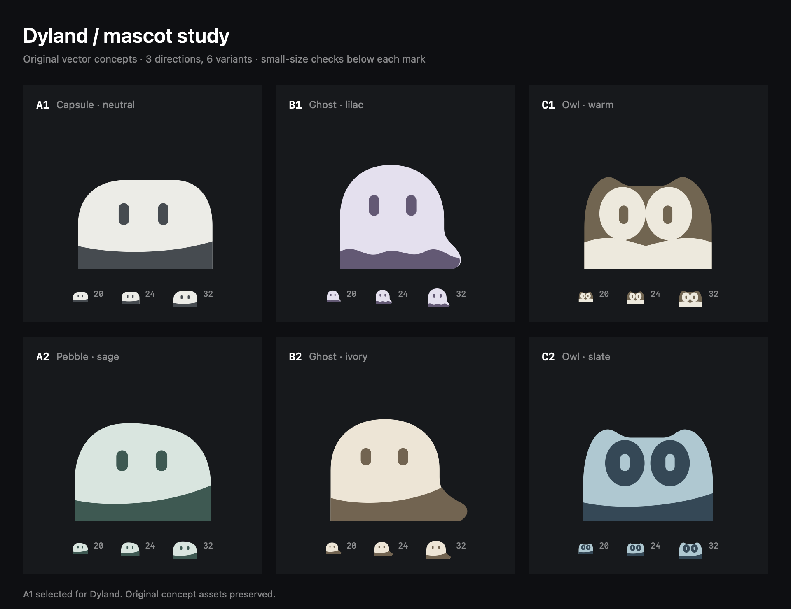

# Dyland mascot concepts

Hand-authored SVG concepts, not AI image-generator output. No existing mascot assets were copied. A1 is the default mascot; B1 Lilac Ghost is also available in General > Appearance. Both background-free native SwiftUI implementations live in `Sources/DylandMark.swift` and share the same eye animations. The six original concept assets below are preserved.



All six source assets are 256 × 256 SVGs with a 128 × 128 viewBox, an opaque `#17191c` background, exactly two subject colors, rounded silhouettes, and two simple eyes. The preview includes 20-, 24-, and 32-point samples.

| ID | Subject and rationale | Subject colors | Asset |
| --- | --- | --- | --- |
| A1 | Neutral capsule; echoes the island silhouette with the least visual noise | `#ecece7`, `#454b50` | [A1-capsule.svg](A1-capsule.svg) |
| A2 | Asymmetric sage pebble; softer companion with a less mechanical silhouette | `#d6e6df`, `#355a52` | [A2-pebble.svg](A2-pebble.svg) |
| B1 | Lilac ghost; suggests a quiet companion appearing when attention is needed | `#e5e0ef`, `#655976` | [B1-ghost.svg](B1-ghost.svg) |
| B2 | Ivory ghost; warmer, calmer treatment with a simpler lower region | `#efe5d4`, `#75634e` | [B2-ghost.svg](B2-ghost.svg) |
| C1 | Warm owl; emphasizes watching sessions, using paired eye regions | `#74644e`, `#eee9dc` | [C1-owl.svg](C1-owl.svg) |
| C2 | Slate owl; cool, higher-contrast face with a broader silhouette | `#a9c9d2`, `#304957` | [C2-owl.svg](C2-owl.svg) |

Recommendation: A1 for minimum distraction, A2 for a little more personality. B1/B2 are more playful. C1/C2 have more internal detail and feel busier at 20 points.

Deliberate deviations from the original image-generation brief: completely flat vector fills, without tonal modeling; capsule and ghost faces use eyes only, with no mouth. All six opaque originals are preserved. The selected A1 app implementation draws the original body geometry on a transparent canvas, cropped to the mascot bounds, and changes eye height for activity states. These variants do not replace the original concept SVGs.

To regenerate the comparison sheet on macOS:

```sh
swift scripts/preview-mascots.swift
```
